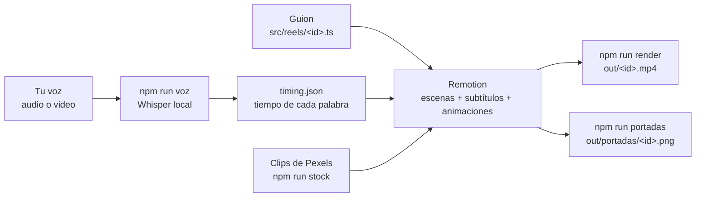

# Reels A&C

Generador de reels de Instagram para **A&C** ([aycsociotech.com](https://aycsociotech.com)), hecho con
[Remotion](https://www.remotion.dev).

A partir de **tu voz** (una grabación de audio o un video tuyo), un **guion** y **clips de stock de Pexels**,
arma un reel vertical (1080×1920) editado con la identidad de la marca. Incluye:

- subtítulos sincronizados palabra por palabra;
- palabras clave en tipografía editorial;
- cortes de B-roll con un look de color parejo;
- animaciones y gráficos;
- llamada a la acción y portada para la cuadrícula del perfil.

Todo corre en tu computadora: la transcripción es local y no se paga ninguna API.

## Cómo funciona



1. **Guion:** escribís el reel como una lista de escenas. Cada una indica qué decís (`vo`) y qué se ve
   (B-roll, planilla, proceso, cierre…).
2. **Voz:** grabás leyendo el guion. Whisper la transcribe en tu PC, la cruza con el texto y calcula cuándo
   decís cada palabra. Con eso, las escenas cambian y los subtítulos aparecen justo a tiempo.
3. **Material:** los clips de stock se buscan y bajan desde Pexels, ya recortados a 9:16.
4. **Render:** Remotion dibuja cada cuadro con React y exporta un MP4 listo para subir.

## Stack tecnológico

| Pieza                                                                                        | Para qué                                                                            |
| -------------------------------------------------------------------------------------------- | ----------------------------------------------------------------------------------- |
| [Remotion 4](https://www.remotion.dev) + React 19                                            | Composición del video con componentes, vista previa (Studio) y render a MP4         |
| TypeScript 5.9                                                                               | Guiones tipados y validados; los scripts corren directo en Node, sin compilar       |
| [whisper.cpp](https://github.com/ggml-org/whisper.cpp) (vía `@remotion/install-whisper-cpp`) | Transcripción local de la voz con marcas de tiempo por palabra (DTW)                |
| Alineación propia (`src/lib/align.ts`, `snap.ts`)                                            | Cruza lo escuchado con el guion y ajusta cada palabra a las pausas reales del audio |
| FFmpeg (incluido en Remotion)                                                                | Conversión de audio, recorte de clips a 9:16, recortes de portadas                  |
| [API de Pexels](https://www.pexels.com/api/)                                                 | Búsqueda y descarga de B-roll con licencia comercial                                |
| Google Fonts (`@remotion/google-fonts`)                                                      | Inter Tight, Instrument Serif, Public Sans y Newsreader                             |
| [Lucide](https://lucide.dev)                                                                 | Íconos de las escenas gráficas                                                      |
| ESLint + Prettier                                                                            | Calidad y formato del código                                                        |

## Requisitos

- [Node.js](https://nodejs.org) **22.18 o superior** (recomendado 24).
- Windows, macOS o Linux. En Windows, Whisper se instala solo; en macOS/Linux hace falta `git` y un compilador
  de C (`make`).
- Opcional: una clave gratuita de Pexels para `npm run stock`.

## Inicio rápido

```bash
npm install
cp .env.example .env          # opcional: pegá tu clave de Pexels
npm run dev                   # abre Remotion Studio con los reels de ejemplo
```

Para hacer un reel nuevo:

1. Copiá `src/reels/riesgo-ia.ts` como `src/reels/mi-reel.ts`, cambiá el `id` y las escenas, y sumalo a
   `src/reels/index.ts`.
2. Conseguí los clips (`npm run stock -- buscar "..."`) y guardalos en `public/reels/mi-reel/b-roll/`.
3. Grabá tu voz como `public/reels/mi-reel/voz.m4a` (o `.mp3`, `.wav`, `.mp4`, `.mov`…) y procesala con
   `npm run voz -- mi-reel`.
4. Revisá con `npm run vista -- mi-reel` y exportá con `npm run render -- mi-reel`.

La guía completa (tipos de escena, voz, portadas, música, problemas comunes) está en [docs/guia.md](docs/guia.md).

## Comandos

| Comando                                                            | Qué hace                                                       |
| ------------------------------------------------------------------ | -------------------------------------------------------------- |
| `npm run dev`                                                      | Abre Remotion Studio (vista previa interactiva)                |
| `npm run voz -- <id>`                                              | Transcribe la voz y sincroniza escenas y subtítulos            |
| `npm run vista -- <id>`                                            | Una imagen por escena en `out/vista/`, para revisar rápido     |
| `npm run render -- <id>`                                           | Exporta el reel a `out/<id>.mp4`                               |
| `npm run portadas [-- <id>]`                                       | Exporta las portadas a `out/portadas/`                         |
| `npm run stock -- buscar "<texto>"`                                | Busca clips verticales en Pexels y arma una hoja de miniaturas |
| `npm run stock -- bajar <id-pexels> --reel=<id> --nombre=<nombre>` | Baja un clip ya recortado a 9:16                               |
| `npm run prompts [-- <id>]`                                        | Lista los prompts de las escenas de imagen generadas con IA    |
| `npm run lint`                                                     | ESLint + verificación de tipos                                 |
| `npm run format`                                                   | Formatea el código con Prettier                                |

> En Windows, usá siempre `npm run …` y no `npx`: si la ruta tiene símbolos como `&`, `npx` falla.

## Estructura

```
src/
  reels/          guiones (un archivo por reel) + index.ts
  covers/         portadas para la cuadrícula del perfil
  scenes/         un componente por tipo de escena (broll, sheet, flow, cta, …)
  components/     composición del reel, subtítulos, logo, fondo
  lib/            alineación voz-guion, tiempos, animaciones, looks de color
  brand.ts        nombre, colores, logo y llamada a la acción de la marca
  theme.ts        tipografías, tamaño del cuadro y zonas seguras de Instagram
  types.ts        tipos del guion (qué campos acepta cada escena)
scripts/          comandos de npm (voz, render, vista, portadas, stock, prompts)
public/
  brand/          logo
  reels/<id>/     voz, clips y tiempos de cada reel (no se suben al repo)
docs/             guía de uso, estilo editorial, material y licencias
```

## Licencias

- **Código:** [MIT](LICENSE). Podés usarlo, modificarlo y redistribuirlo, manteniendo el aviso de copyright.
- **Remotion:** gratis para personas y empresas de hasta 3 personas, incluso con uso comercial. Equipos más
  grandes necesitan una [licencia de empresa](https://www.remotion.pro/license).
- **Material de terceros:** ver [docs/material-y-licencias.md](docs/material-y-licencias.md) (Pexels,
  tipografías, íconos y qué material evitar).
